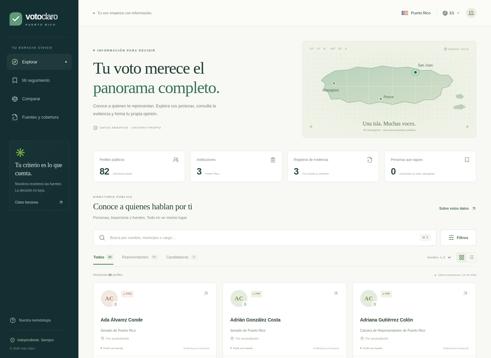

# Voto Claro · Puerto Rico

A bilingual, nonpartisan research workspace for Puerto Rico voters. Search public officials and imported candidates, follow profiles, compare sourced records, and export research as CSV. The interface starts in Spanish; use the language control for English.



## Run it

Requires Node.js 24+ and npm. No API keys, external database, or paid services are required.

```bash
npm ci --cache /tmp/voto-claro-npm-cache
npm run dev
```

Vite runs on port 5173 and proxies `/api` to Express on port 3001. For a production build:

```bash
npm run build
npm start
```

Express serves both the built site and API on port 3001. Set `PORT` to change the production port. When hosting behind a proxy, preserve the Host header and configure `ALLOWED_ORIGINS` with the exact public application origin to enable browser directory refreshes. This is a local/research MVP; origin validation is not user authentication. Add authentication and rate limits before exposing mutations on a public multi-user deployment.

## What is included

- An initial snapshot of **82 profiles** in the Open States Puerto Rico registry, including legislature and governor records, with official profile links and retrieval dates. These are registry records, **not certified seat counts or a claim that all listed offices are independently verified**.
- Accent-insensitive search, party/institution/evidence-topic filters, card/list views, profile dossiers, and a browser-local watchlist.
- Comparison of up to three people, with statements, actions and votes shown separately; sourced CSV exports for research workflows.
- A real registry refresh pipeline, explicit source status, atomic local persistence, and preservation of the last complete snapshot on network or validation failures.
- Three reviewed, source-linked La Fortaleza releases (October 2026), clearly labeled as official announcements rather than independently verified outcomes. No roll-call votes are seeded.
- An allowlisted official Puerto Rico HTML scraper that saves **unreviewed drafts**, plus validated, local imports for reviewed evidence and candidates.
- Spanish/English interface, responsive layouts, keyboard-accessible dialogs and mobile navigation.

The app does not invent records, infer positions from party affiliation, recommend candidates, or calculate political integrity scores. Missing evidence stays unknown. The initial version does not claim comprehensive policy or vote coverage, and has no certified candidate feed. Any imported past candidacy must retain its election year and historical status.

## Refresh and research

```bash
npm run sync
npm run scrape -- --url 'https://www.fortaleza.pr.gov/' \
  --person 'ocd-person/2ec9fa1f-8254-4602-a5cd-14f849c2d5e9' \
  --type statement --issue governance
npm run import:evidence -- --file reviewed-evidence.json
npm run import:candidates -- --file reviewed-candidates.json
```

The scraper only accepts fixed official Puerto Rico hostnames, rejects redirects, and applies size/time limits with TLS verification intact. It stores title/text and retrieval metadata under `.local/drafts/`. A requested type is a research hint, not evidence that a person took an action or voted a particular way. Review attribution, original text, date and context before preparing an evidence import. Drafts are never automatically published.

See [data maintenance instructions](scripts/README.md) for exact schemas, safeguards and lock recovery. [candidates.example.json](scripts/candidates.example.json) is an explicitly fictional template, not a real candidate list; replace every placeholder after checking the original election source.

The initial directory is `data/seed.json`. Runtime changes are saved to ignored `.local/database.json`; back up that directory to preserve reviewed research. The tracked source catalog is `data/catalog.json`. A refresh updates those known profile URLs; it does not automatically discover newly added registry files. Add reviewed catalog URLs when roster membership changes. Live processes and browser watchlists are not part of the source snapshot.

## Validation

```bash
npm test
npm run build
npm run test:e2e
```

Browser tests start or reuse the development server. This cloud environment has Chromium at `/usr/bin/chromium`. Elsewhere run `npx playwright install chromium`; use `CHROMIUM_PATH` for a system browser. Set `PLAYWRIGHT_BASE_URL` to test an already running production server.

Tests cover source restrictions, schema validation, candidate history, draft isolation, failed refresh preservation, CSV formula injection, storage locks, API behavior, search, watchlists, comparison, bilingual controls, keyboard focus and narrow screens.

## API and architecture

- `GET /api/health` — readiness and record counts.
- `GET /api/data` — profiles, evidence, sources and last successful refresh.
- `GET /api/export.csv?id=PERSON_ID&id=OTHER_ID` — source-linked research export; omit IDs for all profiles.
- `POST /api/sync` — refresh the fixed registry catalog; a failed refresh returns HTTP 502 with preserved data and visible source errors.

`src/` contains the React/TypeScript application; `server/` contains Express, validation, storage and ingestion; `scripts/` provides local research commands. No arbitrary URL scraping or evidence publishing endpoint is exposed. Reviewed imports are explicit CLI operations.

## Source attribution and limitations

Open States people data is maintained by the civic community and dedicated to the public domain under [CC0 1.0](https://github.com/openstates/people/blob/main/LICENSE). [Puerto Rico registry](https://github.com/openstates/people/tree/main/data/pr), catalog discovery commit `0360b5d278b84420ba88a238917bb5aaf7f6d6bb`. Each profile retains its source and snapshot date. Registry entries may be incomplete or stale: dates indicate retrieval, not independent confirmation of tenure or affiliation. In particular, do not interpret directory totals as certified legislature membership.

Official reference sources include La Fortaleza, the Office of Legislative Services' SUTRA system and Puerto Rico's State Elections Commission (CEE). Official legislative votes, election certification and campaign statements require additional source adapters or reviewed imports; linked sources alone do not mean a feed is connected. HTML scraping extracts readable text, not scanned PDFs or JavaScript-only data. Social platforms, comprehensive archives, address-to-district lookup, accounts, notification delivery, billing and deployment are not included.

Code is MIT-licensed; source material retains its original terms. This project is independent and is not affiliated with a political party, candidate, election authority or government office.
